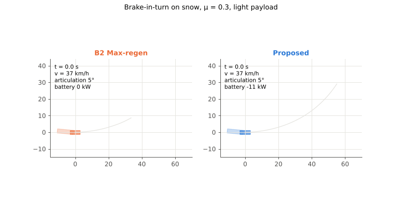
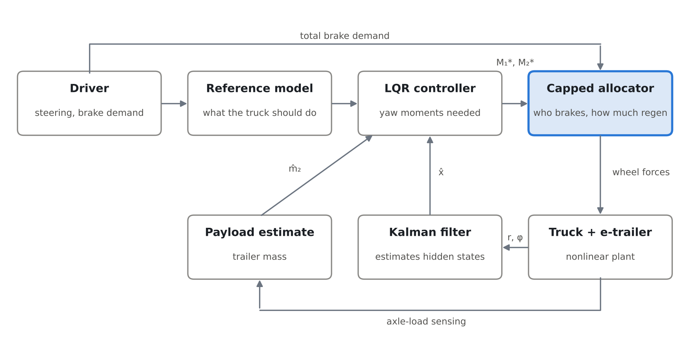
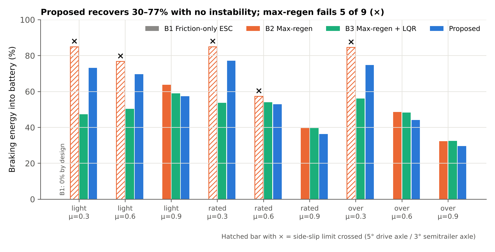
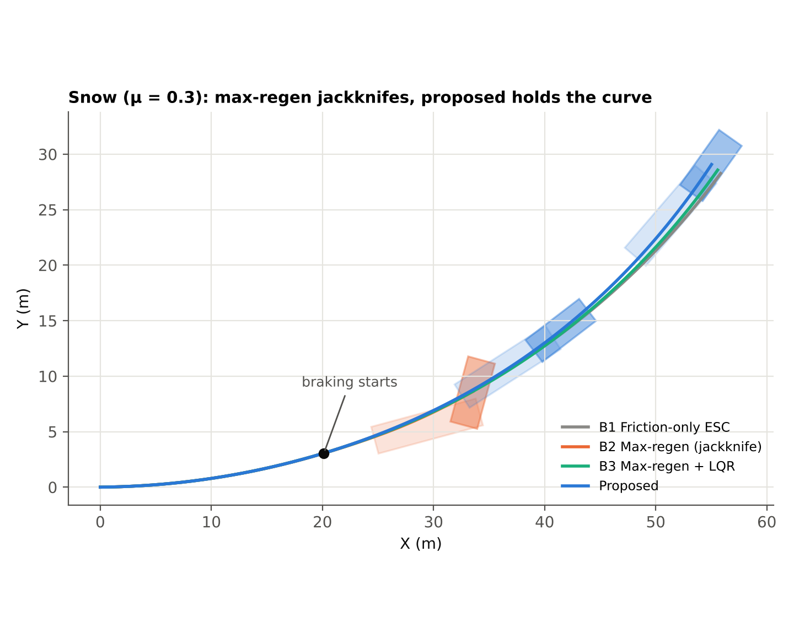
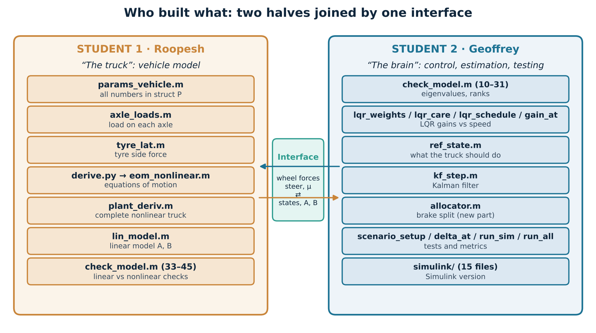
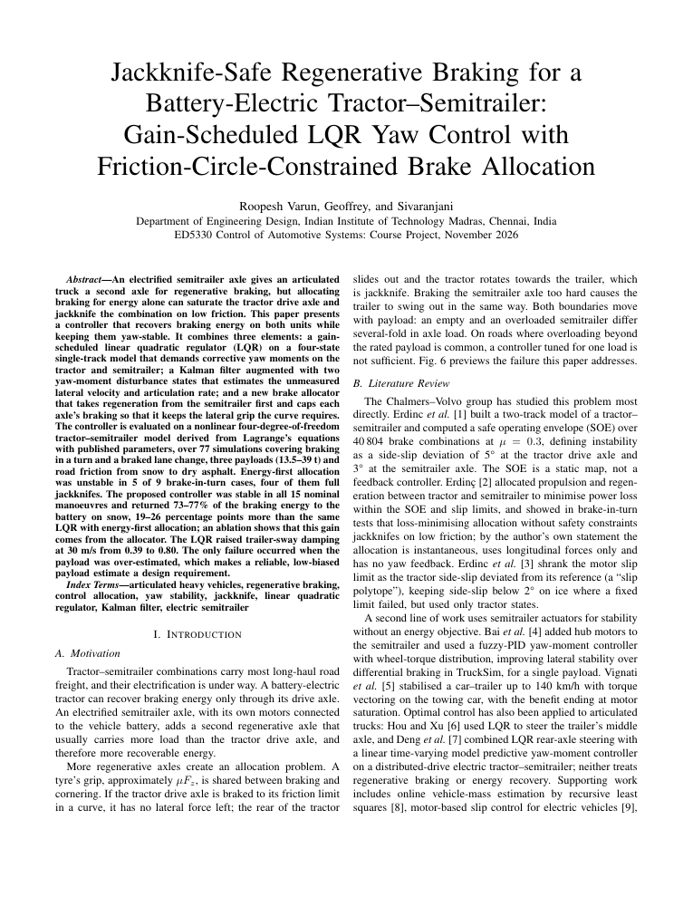

# Jackknife-Safe Regenerative Braking for a Battery-Electric Tractor–Semitrailer


**How much braking energy can an electric truck with an electric semitrailer recover, without jackknifing?**

Course project for **ED5330 Control of Automotive Systems**, IIT Madras, November 2026.
Team: **Roopesh Varun**, **Geoffrey**, **Sivaranjani**.

📄 **Paper:** [*Jackknife-Safe Regenerative Braking for a Battery-Electric Tractor–Semitrailer: Gain-Scheduled LQR Yaw Control with Friction-Circle-Constrained Brake Allocation*](docs/ED5330_P1_IEEE_Paper.pdf) (IEEE two-column format, 9 pages; LaTeX source in [`paper/`](paper/))



*Braking in a 72 m curve on snow (μ = 0.3). Putting all regenerative braking on the tractor's drive axle jackknifes the truck within 1.6 s; the proposed controller holds the curve while still recovering 73% of the braking energy.*

---

## Contents

- [The problem](#the-problem)
- [What we built](#what-we-built)
- [Key results](#key-results)
- [How to run](#how-to-run)
- [Repository structure](#repository-structure)
- [Who did what](#who-did-what)
- [Assumptions and limitations](#assumptions-and-limitations)
- [Paper](#paper)
- [Reference](#reference)

---

## The problem

An electric semitrailer has its own motors, so the truck has a second place to recover braking energy. But a tyre's grip, about μ × axle load, is shared between braking and cornering. If the tractor's drive axle uses all its grip for regenerative braking in a curve, it has no side force left, the tractor's rear slides out and the truck **jackknifes**.

**Goal:** split every brake demand over the six wheels so that the most energy reaches the battery, while

1. the drive-axle slip angle changes by at most 5° and the semitrailer axle's by at most 3° (limits from Erdinc et al. 2023);
2. motor, battery and tyre limits are respected;
3. this works for payloads of 13.5 to 39 t and road friction from snow (μ 0.3) to dry asphalt (μ 0.9).

## What we built



| Step | Component | File(s) |
|---|---|---|
| 1 | **Nonlinear 4-DOF tractor–semitrailer model**: Lagrange's equations derived in SymPy, tanh tyres with the friction circle, quasi-static load transfer, RK4 at 5 ms | `derive.py`, `eom_nonlinear.m`, `plant_deriv.m`, `tyre_lat.m`, `axle_loads.m`, `params_vehicle.m` |
| 2 | **Linear single-track design model**, checked against the nonlinear one; controllability and observability | `lin_model.m`, `check_model.m` |
| 3 | **Augmented Kalman filter** (two disturbance states) and **gain-scheduled LQR** (one gain per speed, 3–30 m/s) | `kf_step.m`, `lqr_care.m`, `lqr_schedule.m`, `lqr_weights.m`, `gain_at.m`, `ref_state.m` |
| 4 | **Stability-capped regen allocator (the new part)**: per-axle caps from the friction circle, semitrailer regen first, yaw moments by left/right braking | `allocator.m` |
| 5 | **Evaluation**: 77 simulations, four controllers, regen share and slip-angle metrics; Simulink version built by script | `run_sim.m`, `run_all.m`, `scenario_setup.m`, `simulink/` |

The controller runs every 10 ms and sees only a noisy yaw rate and articulation angle.

**Controllers compared**

| Name | Braking | Yaw control |
|---|---|---|
| B1 | Friction only, by axle load | LQR |
| B2 | Maximum regen, drive axle first | None |
| B3 | Maximum regen, drive axle first | LQR (ablation: same as proposed except the allocator) |
| **Proposed** | Capped regen, semitrailer first | LQR |

## Key results

| Result | Value |
|---|---|
| Unstable runs, proposed controller | **0 of 15** (9 brake-in-turn, 6 lane change) |
| Unstable runs, B2 (max regen) | 5 of 9 brake-in-turn cases (4 full jackknifes) |
| Braking energy recovered on snow, proposed | **73.1 / 77.1 / 74.7 %** (13.5 / 30 / 39 t) |
| Same, B3 (same LQR, no stability-capped allocator) | 47.3 / 53.7 / 56.0 % |
| Gain from the allocator on snow | **+19 to +26 percentage points** |
| Price of safety on good roads | B3 ahead by 1–4 points in 5 of 6 wet/dry cases |
| Trailer-sway damping at 30 m/s | 0.39 open loop → 0.80 with LQR |
| Only failure | Light trailer assumed overloaded: trailer slip change 4.26° > 3° |

<p align="center">
  
  
</p>

All numbers come from `results/metrics.csv` (one line per run) and `results/model_checks.txt`.

## How to run

**Requirements:** MATLAB R2019b or later (Simulink only for step 4). No toolboxes are needed: the LQR Riccati equation is solved with basic MATLAB. The figures are drawn with Python 3 (numpy, pandas, scipy, matplotlib).

1. Download or clone this repository.
2. Open MATLAB in the repository folder.
3. Run `main.m`, or the steps on their own:

| Step | Command | Output |
|---|---|---|
| Model checks | `run src/check_model.m` | `results/model_checks.txt`, `results/poles.csv` |
| All 77 runs (a few minutes) | `run src/run_all.m` | `results/metrics.csv`, `results/logs_light.mat` |
| Live demo | `animate_run(0.3, 'light', {'emax', 'prop'})` | animated top view |
| Simulink | `build_simulink_model; sim('P1_tractor_etrailer'); sl_results` | Simulink model and comparison with the script |
| Figures | `python src/figs.py` | `figs/*.png`, `figs/*.gif` |

A single run:

```matlab
addpath('src');
sc = struct('type','bit','mode','prop','mu',0.3,'payload','light', ...
            'payload_ctrl','light','sensors','r_phi','seed',1,'Pbat',[]);
R = run_sim(sc);
R.regen_share   % 0.731
R.unstable      % 0
```

Change `'prop'` to `'emax'` to see the max-regen controller jackknife.

> **Note.** The results in `results/` were produced with GNU Octave 8.4. MATLAB uses a different random-number generator for the sensor noise, so the last digits can differ slightly (other noise seeds changed the snow result by under 1 point). The Simulink model is generated by `build_simulink_model.m`; it was checked with `sl_emulate.m`, which runs the same blocks in order and reproduces the script result exactly.

## Repository structure

```
.
├── main.m                 Runs everything, in four steps
├── src/                   MATLAB functions (model, controller, allocator, simulation)
│   └── derive.py          SymPy derivation that writes eom_nonlinear.m and lin_model.m
├── simulink/              Script that builds the Simulink model, and its block wrappers
├── results/               metrics.csv, model_checks.txt, poles.csv, logs_light.mat
├── figs/                  Figures and the demo animation
├── docs/                  The paper (PDF)
└── paper/                 LaTeX source of the paper (IEEEtran) and its figures
```

## Who did what



| | Roopesh Varun | Geoffrey |
|---|---|---|
| Part | Vehicle model ("the truck") | Control, estimation, allocation and testing |
| Files | `params_vehicle`, `axle_loads`, `tyre_lat`, `derive.py`, `eom_nonlinear`, `plant_deriv`, `lin_model`, model checks | rank checks, LQR files, `ref_state`, `kf_step`, `allocator`, `scenario_setup`, `run_sim`, `run_all`, `animate_run`, `simulink/` |

Sivaranjani is the third member of the team.

## Assumptions and limitations

- **Simulation only.** The model is verified (two formulations agree, geometric checks pass) but not validated against measurements from a real truck.
- **Planar model.** No roll; lateral acceleration is kept at or below 2.5 m/s².
- **Ideal actuators.** No brake or motor delays; wheel forces held within μ × load (ideal slip control).
- **Known quantities.** Road friction, speed and deceleration are assumed known; friction-estimation errors were not tested.
- **No drag, rolling resistance or slope**, so energy shares are slightly optimistic.
- **Representative values.** Vehicle parameters at 13.5 t are published; the 30 t and 39 t payloads, motor and battery limits, LQR limits and allocator safety factors are our choices.

## Paper

<a href="docs/ED5330_P1_IEEE_Paper.pdf"></a>

The full write-up is in [`docs/ED5330_P1_IEEE_Paper.pdf`](docs/ED5330_P1_IEEE_Paper.pdf):

1. **Introduction**: motivation, literature review, research gap and contributions
2. **Modelling and methodology**: Lagrangian model, tyre and load models, linear model and its observability, gain-scheduled LQR, augmented Kalman filter and the stability-capped allocator
3. **Simulation setup**: parameters, manoeuvres, the 77-run matrix and metrics
4. **Results and discussion**: stability, energy and ablation, lane change, robustness and limitations
5. **Conclusion** and future work

To rebuild it, open `paper/paper.tex` in [Overleaf](https://www.overleaf.com) or run `latexmk -pdf paper.tex` inside `paper/`.

<br clear="right">

**Cite this work**

```bibtex
@misc{varun2026jackknifesafe,
  author       = {Roopesh Varun and Geoffrey and Sivaranjani},
  title        = {Jackknife-Safe Regenerative Braking for a Battery-Electric
                  Tractor--Semitrailer: Gain-Scheduled {LQR} Yaw Control with
                  Friction-Circle-Constrained Brake Allocation},
  howpublished = {ED5330 Control of Automotive Systems course project,
                  Indian Institute of Technology Madras},
  year         = {2026},
  month        = nov
}
```

## Reference

Erdinc, U., Jonasson, M., Sadeghi Kati, M., Jacobson, B., Fredriksson, J., Laine, L. (2023). *Modelling of articulated heavy vehicles for computation of accurate safe operating envelope for yaw stability.* Technology Convergence 2023. [research.chalmers.se/publication/538592](https://research.chalmers.se/publication/538592)
Source of the vehicle parameters, tyre model structure, brake-in-a-turn test and stability limits. The full literature review is in [the paper](docs/ED5330_P1_IEEE_Paper.pdf).

## License

[MIT](LICENSE)
